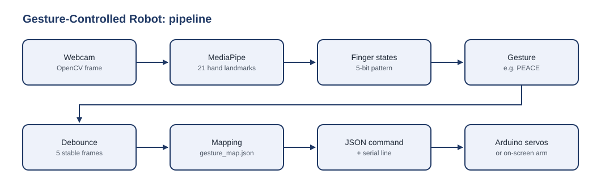

# Gesture-Controlled Robot Arm

**Python · Computer Vision · MediaPipe · OpenCV · JSON · Arduino**

Control a 4-joint robot arm with hand gestures in front of a webcam. A computer-vision pipeline tracks the hand, recognises the gesture, and maps it to an actuator command through a JSON configuration file. Commands drive real servos through an Arduino, or a simulated arm on screen.

📘 **[Technical manual](docs/TECHNICAL_MANUAL.md)**: full pipeline documentation, gesture reference, setup, wiring and troubleshooting.

> **Status:** Pipeline, mapping and Arduino controller complete; 16 unit tests passing. Runs with a webcam and an on-screen simulated arm; servo hardware is optional.



## Gestures

| Gesture | Command | Effect |
|---------|---------|--------|
| ✊ Fist | `GRIPPER_CLOSE` | Close gripper |
| ✋ Open palm | `GRIPPER_OPEN` | Open gripper |
| ☝️ Point | `BASE_LEFT` | Rotate base left (hold to keep turning) |
| ✌️ Peace | `BASE_RIGHT` | Rotate base right |
| 👍 Thumbs up | `ARM_UP` | Raise shoulder |
| 🤟 Three fingers | `ARM_DOWN` | Lower shoulder |

The mapping is stored in [`gesture_map.json`](gesture_map.json), so gestures can be reassigned without touching the code.

## Quick start

```bash
pip install -r requirements.txt

python run.py --demo           # no camera needed: runs a scripted gesture sequence
python download_model.py       # MediaPipe hand model (~8 MB)
python run.py                  # webcam + simulated arm on screen
python run.py --serial COM3    # also drive real servos through the Arduino
```

Each accepted gesture prints a JSON command:

```json
{"gesture": "PEACE", "command": "BASE_RIGHT", "joint": "base", "from": 90, "to": 95, "at_limit": false, "angles": {"base": 95, "shoulder": 90, "elbow": 90, "gripper": 90}}
```

## Design decisions

- **Tilt-tolerant finger detection.** A finger counts as extended when its tip is further from the wrist than its middle joint. Checking "tip above joint" would fail when the hand is tilted. Tested at 35°.
- **Scale-independent thumb detection.** Thumb distance is divided by hand size, so it works near or far from the camera.
- **Debouncing.** A gesture must be stable for 5 frames before it's accepted, which stops the arm twitching while the hand changes shape.
- **Step vs target commands.** Movement gestures repeat while held; gripper gestures fire once.
- **Limits enforced twice:** in Python and again on the Arduino, so a bad command can't drive a joint into its end stop.
- **Smooth servo motion.** The Arduino moves each servo one degree at a time towards its target instead of jumping.

## Tests

```bash
python -m unittest discover -s tests -v
```

16 tests use synthetic hand landmarks built from geometry, so they run without a camera or model. They cover all six gestures, tilt tolerance, unknown patterns, debouncing, both command types, joint limits and the serial format.

## Project structure

```
gesture-controlled-robot/
├── gesture/
│   ├── classifier.py     # landmarks → finger states → gesture, debouncer
│   └── arm.py            # gesture → command, joint angles and limits
├── gesture_map.json      # gesture-to-actuator mapping
├── run.py                # webcam app, demo mode, serial output
├── download_model.py
├── arduino/servo_controller/servo_controller.ino
├── tests/test_gestures.py
└── docs/
    ├── TECHNICAL_MANUAL.md
    ├── architecture.svg
    └── wiring.svg
```

## Limitations and next steps

- One hand at a time; lighting and background affect tracking
- The elbow joint has no gesture assigned yet (a two-hand mode is planned)
- Planned: inverse kinematics, so gestures can move the gripper to a point instead of moving one joint at a time

## Author

**Gabriel Timilehin Joshua: Mechanical Engineer, AI Training & Evaluation, Technical Writer
