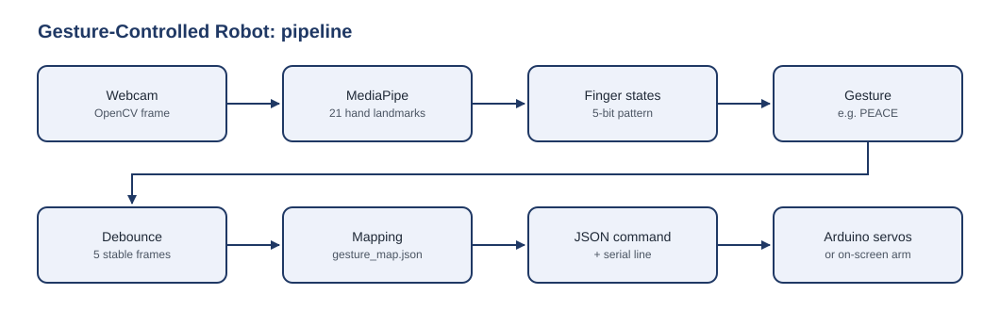
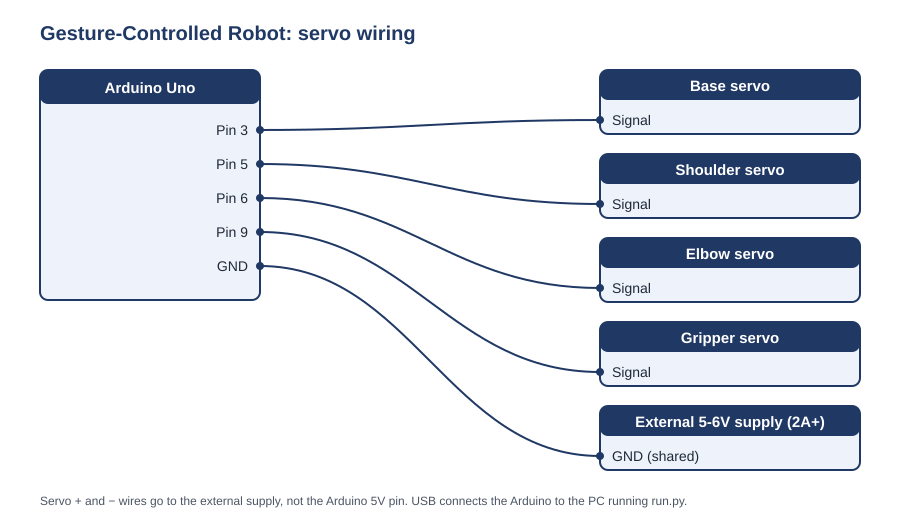

# Technical Manual: Gesture-Controlled Robot Arm

**Document scope:** how the computer-vision pipeline turns a hand gesture into a robot-arm movement, how to set up and operate the system, and how to troubleshoot it.

---

## 1. System overview

| Stage | Component | Input | Output |
|-------|-----------|-------|--------|
| 1. Capture | Webcam + OpenCV | Light | BGR video frame |
| 2. Hand tracking | MediaPipe Hand Landmarker | RGB frame | 21 hand landmarks (x, y in 0–1) |
| 3. Finger states | `gesture/classifier.py` | 21 landmarks | 5-bit pattern, e.g. `01100` |
| 4. Gesture | `gesture/classifier.py` | Finger pattern | Gesture name, e.g. `PEACE` |
| 5. Debounce | `Debouncer` | Gesture per frame | Accepted gesture (stable for 5 frames) |
| 6. Mapping | `gesture_map.json` + `gesture/arm.py` | Accepted gesture | JSON command + new joint angles |
| 7. Actuation | `arduino/servo_controller.ino` | Serial line `base:95,...` | Servo movement |



---

## 2. Gesture reference

| Gesture | Finger pattern (T I M R P) | Command | Joint | Action |
|---------|---------------------------|---------|-------|--------|
| ✊ Fist | `00000` | `GRIPPER_CLOSE` | gripper | Go to 10° (closed) |
| ✋ Open palm | `11111` or `01111` | `GRIPPER_OPEN` | gripper | Go to 90° (open) |
| ☝️ Point | `01000` | `BASE_LEFT` | base | −5° per step |
| ✌️ Peace | `01100` | `BASE_RIGHT` | base | +5° per step |
| 👍 Thumbs up | `10000` | `ARM_UP` | shoulder | +5° per step |
| 🤟 Three fingers | `01110` | `ARM_DOWN` | shoulder | −5° per step |

**Step** gestures repeat every frame while the gesture is held, so holding ✌️ keeps turning the base. **Target** gestures (fist, open palm) fire once.

---

## 3. How finger detection works

MediaPipe numbers the landmarks: 0 = wrist; thumb 1–4; index 5–8; middle 9–12; ring 13–16; pinky 17–20 (each finger: knuckle, middle joint, upper joint, tip).

**Index to pinky:** a finger is *extended* if its tip is more than 15% further from the wrist than its middle joint (PIP).

```
extended = distance(wrist, tip) > 1.15 × distance(wrist, PIP)
```

Comparing distances from the wrist, rather than checking whether the tip is "above" the joint, means detection still works when the hand is tilted. This is covered by a unit test at 35° tilt.

**Thumb:** the thumb bends sideways, so it uses a different test. It is *extended* if its tip is far from the index knuckle relative to hand size:

```
extended = distance(thumb_tip, index_knuckle) / distance(wrist, middle_knuckle) > 0.55
```

Dividing by hand size makes the rule work at any distance from the camera.

---

## 4. Debouncing

When the hand changes from one gesture to another, it passes through shapes in between (for example, fist → point can briefly look like an unknown pattern). Without filtering, the arm would twitch.

The `Debouncer` only accepts a gesture after it has appeared in **5 consecutive frames** (about 0.17 s at 30 fps). Any change resets the count.

---

## 5. Command format

Every accepted gesture produces one JSON line on the console:

```json
{"gesture": "PEACE", "command": "BASE_RIGHT", "joint": "base", "from": 90, "to": 95,
 "at_limit": false, "angles": {"base": 95, "shoulder": 90, "elbow": 90, "gripper": 90}}
```

| Field | Meaning |
|-------|---------|
| `gesture` | Accepted gesture |
| `command` | Command name from `gesture_map.json` |
| `joint` | Joint that moved |
| `from` / `to` | Angle before and after, in degrees |
| `at_limit` | `true` if the joint hit its safety limit |
| `angles` | All joint angles after the command |

The line sent to the Arduino over serial is shorter: `base:95,shoulder:90,elbow:90,gripper:90\n`.

### Changing the mapping

Edit `gesture_map.json`; no code changes needed. Use `"step"` for relative moves or `"target"` for absolute positions:

```json
"PEACE": { "command": "BASE_RIGHT", "joint": "base", "step": 5 }
```

---

## 6. Joint limits

Limits protect the mechanism from driving into its end stops. They are enforced twice: in Python (`gesture/arm.py`) and again on the Arduino.

| Joint | Min | Max | Start |
|-------|-----|-----|-------|
| base | 0° | 180° | 90° |
| shoulder | 15° | 165° | 90° |
| elbow | 0° | 180° | 90° |
| gripper | 10° | 90° | 90° |

---

## 7. Setup

### Software

```bash
pip install -r requirements.txt
python download_model.py        # MediaPipe hand model, ~8 MB
python run.py --demo            # check the logic without a camera
python run.py                   # webcam + simulated arm on screen
```

### Hardware (optional)

1. Upload `arduino/servo_controller/servo_controller.ino` to an Arduino Uno.
2. Connect servo signal wires: base → pin 3, shoulder → pin 5, elbow → pin 6, gripper → pin 9.
3. Power the servos from a **separate 5–6 V supply** rated for at least 2 A. Connect its ground to Arduino GND.
4. Run `python run.py --serial COM3` (Windows) or `--serial /dev/ttyUSB0` (Linux).



---

## 8. Troubleshooting

| Symptom | Likely cause | Fix |
|---------|--------------|-----|
| "Model not found" | Model not downloaded | Run `python download_model.py` |
| "No hand" shown with hand in view | Poor lighting or busy background | Face a light source; use a plain background |
| Gesture flickers between two names | Fingers half-bent | Make gestures clearly; increase debounce frames |
| Thumbs up read as fist | Thumb close to the index finger | Point the thumb further out to the side |
| Servos jitter or Arduino resets | Servos powered from Arduino 5 V | Use a separate servo supply with shared ground |
| No movement but JSON prints | Wrong serial port | Check the port in Device Manager or `ls /dev/tty*` |

---

## 9. Testing

```bash
python -m unittest discover -s tests -v
```

16 tests use synthetic landmarks (built from geometry, no camera needed) to check every gesture, tilt tolerance, debouncing, step and target commands, joint limits and the serial line format.
